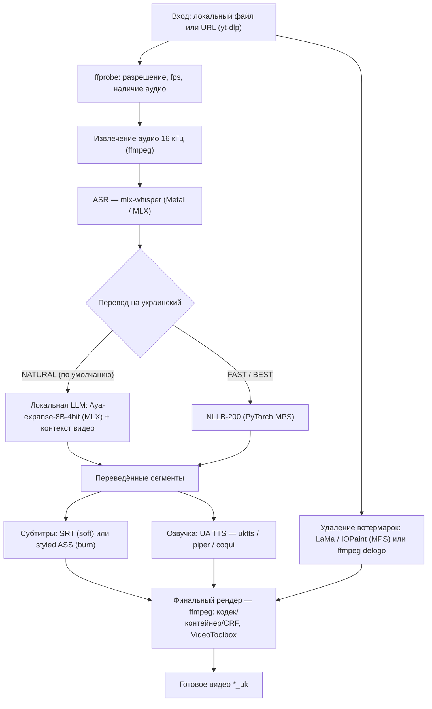

# Архитектура Vidloc

Технический разбор: как устроен пайплайн, какие модели используются и почему приняты
ключевые инженерные решения.

## TL;DR

- **Полностью локально, офлайн.** Весь AI-инференс выполняется на машине пользователя.
  Сеть нужна только для (1) разовой загрузки моделей с Hugging Face Hub и (2) опционального
  скачивания видео по ссылке (`yt-dlp`). **Облачных inference-API нет, данные никуда не уходят.**
- **Ускорение через Apple Metal.** ASR и переводящая LLM — на **MLX**; NLLB — на **PyTorch MPS**;
  нейро-inpainting (LaMa) — на **MPS**; кодирование видео — опционально на **VideoToolbox**.
- **Движок отделён от интерфейса.** Ядро (`PipelineRunner`) не знает про GUI: общается с
  `Reporter` (прогресс/отмена), поэтому GUI и CLI используют один и тот же конвейер.

## Пайплайн



Порядок задаётся в `pipeline/runner.py`. Стадии включаются по `JobConfig` (что именно
нужно сделать), а **inpaint (GPU) и озвучка (CPU) выполняются параллельно** в одной стадии
`process` — пока видеокарта чистит кадры, процессор синтезирует речь.

## Стадии и модели

| Стадия | Что делает | Модель / движок | Ускорение |
|---|---|---|---|
| **ASR** | речь → текст с таймкодами | `whisper-large-v3-mlx` (BEST, по умолч.), `whisper-large-v3-turbo` (BALANCED), `whisper-medium-mlx` (FAST) | Metal (MLX) |
| **Перевод · NATURAL** | идиоматичный, со сленгом, по смыслу | `mlx-community/aya-expanse-8b-4bit` (Cohere Aya) | Metal (MLX) |
| **Перевод · FAST/BEST** | дословный, быстрый (фолбэк) | `facebook/nllb-200-distilled-600M` / `-1.3B` | Metal (PyTorch MPS) |
| **Озвучка** | текст → украинская речь | ukrainian-tts (5 голосов), Piper ONNX (3 голоса), Coqui `uk/mai/vits` (фолбэк) | CPU (subprocess) |
| **Удаление вотермарок** | inpainting региона | **LaMa** через IOPaint (QUALITY), `ffmpeg delogo` (FAST) | Metal (MPS) / ffmpeg |
| **Рендер** | сборка итогового видео | ffmpeg: H.264 / H.265, mp4 / mkv / mov / webm | VideoToolbox (опц.) |

Выбор устройства — `settings.torch_device()`: `mps` → `cuda` → `cpu`. На Apple Silicon это MPS;
`PYTORCH_ENABLE_MPS_FALLBACK=1` отправляет на CPU те редкие операции, которых ещё нет на MPS,
вместо падения.

## Почему именно так — инженерные решения

- **Никаких облачных API.** Приватность и работа без интернета — приоритет. Всё крутится
  локально; единственный сетевой трафик — разовая загрузка весов и (по желанию) видео по ссылке.

- **Изолированные venv + subprocess-воркеры.** Движки озвучки и inpainting конфликтуют по
  зависимостям с ядром (где `transformers 5`) и между собой (разные версии torch, ESPnet / VITS /
  ONNX). Поэтому каждый из них живёт в своём venv (`.venv-uktts`, `.venv-tts`, `.venv-piper`,
  `.venv-inpaint`) и вызывается как отдельный процесс. Ядро остаётся чистым и стабильным.

- **LLM для перевода вместо «дословного».** NLLB переводит буквально; для живого языка
  по умолчанию используется локальная LLM (Aya) с **контекстным проходом**: модель сначала
  одним запросом резюмирует тему всего ролика, и этот контекст плюс заголовок/описание видео
  (из `yt-dlp`) подмешиваются в каждый кусок перевода — так снимается двусмысленность слов
  (например, «drift» в видео про дрифт переводится по смыслу, а не буквально).

- **Параллелизм GPU ∥ CPU.** Inpaint грузит видеокарту, TTS — процессор, поэтому они
  запускаются одновременно (`ThreadPoolExecutor`). ASR читает оригинальную аудиодорожку, что
  позволяет ставить inpaint после перевода и совмещать его с озвучкой.

- **Мягкая деградация.** Если LLM-перевод по какой-то причине недоступен, конвейер
  автоматически откатывается на NLLB и доводит задачу до конца.

- **Один источник истины для настроек.** `JobConfig` (dataclass в `models.py`) связывает каждый
  переключатель GUI с движком — интерфейс и конвейер не расходятся.

- **Безопасность ffmpeg-фильтрграфа.** Путь проекта содержит пробел, на котором спотыкается
  фильтр `subtitles`, поэтому файлы субтитров перед прожигом копируются во временный путь без
  пробелов.

## Карта кода

```
vidloc/
  settings.py          пути, env, выбор устройства (MPS/CPU), HF_HOME → models/
  models.py            enum'ы + JobConfig (единая конфигурация задачи)
  media/
    ffmpeg.py          probe / extract_audio / render_video, VideoToolbox
    fetch.py           скачивание по URL (yt-dlp), извлечение контекста
  asr/                 распознавание речи (mlx-whisper)
  translate/
    llm.py             натуральный перевод (Aya, MLX) + контекстный проход
    translator.py      дословный перевод (NLLB-200, MPS)
  subtitles/
    srt.py             мягкие субтитры (.srt)
    ass.py             стилизованные вшитые субтитры (.ass, libass + Montserrat)
    rechunk.py         нарезка на короткие реплики (TikTok/Reels-вид)
  tts/
    dubbing.py         оркестрация озвучки, тайм-фиттинг к темпу оригинала
    uktts_worker.py    ukrainian-tts (subprocess в .venv-uktts)
    piper_worker.py    Piper ONNX (subprocess в .venv-piper)
    coqui_worker.py    Coqui VITS (subprocess в .venv-tts)
  inpaint/
    lama.py            нейро-inpainting LaMa через IOPaint (MPS)
    delogo.py          быстрый ffmpeg delogo
  pipeline/
    runner.py          оркестрация всех стадий (см. диаграмму выше)
    events.py          прогресс и отмена (Reporter / StageTracker)
  gui/                 PySide6: окно, воркер-поток, выбор региона
  cli.py               headless-запуск
```
