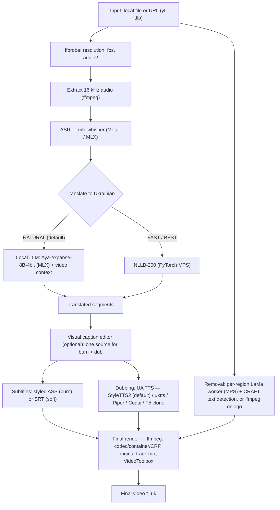

# Vidloc architecture

**English** · [Русский](ARCHITECTURE.ru.md)

A technical walkthrough: how the pipeline works, which models are used, and the reasoning
behind the key engineering decisions.

## TL;DR

- **Fully local, offline.** All AI inference runs on the user's machine. The network is only used
  for (1) a one-time model download from the Hugging Face Hub and (2) optional video download by
  URL (`yt-dlp`). **There are no cloud inference APIs — no data leaves the device.**
- **Apple Metal acceleration.** ASR and the translation LLM run on **MLX**; NLLB runs on
  **PyTorch MPS**; neural inpainting (LaMa) runs on **MPS**; video encoding optionally uses
  **VideoToolbox**.
- **Engine decoupled from the UI.** The core (`PipelineRunner`) knows nothing about the GUI — it
  talks to a `Reporter` (progress/cancel), so the GUI and the CLI share the same pipeline.

## Pipeline



Stage order lives in `pipeline/runner.py`. Stages are switched on by `JobConfig` (what actually
needs doing), and **inpainting (GPU) and dubbing (CPU) run in parallel** in a single `process`
stage — while the GPU cleans frames, the CPU synthesizes speech. When the visual editor has
authored captions they are the single source of truth for both the burned-in subtitles and the
dub, so ASR/translation are skipped on that run.

## Stages and models

| Stage | What it does | Model / engine | Acceleration |
|---|---|---|---|
| **ASR** | speech → timestamped text | `whisper-large-v3-mlx` (BEST, default), `whisper-large-v3-turbo` (BALANCED), `whisper-medium-mlx` (FAST) | Metal (MLX) |
| **Translate · NATURAL** | idiomatic, slang-aware, by meaning | `mlx-community/aya-expanse-8b-4bit` (Cohere Aya) | Metal (MLX) |
| **Translate · FAST/BEST** | literal, fast (fallback) | `facebook/nllb-200-distilled-600M` / `-1.3B` | Metal (PyTorch MPS) |
| **Dubbing** | text → Ukrainian speech | **StyleTTS2-Ukrainian** (default, 20 voices), ukrainian-tts (5), Piper ONNX (3), Coqui `uk/mai/vits` (fallback), F5-TTS (voice clone) | MPS / CPU (subprocess) |
| **Removal** | per-region, time-gated inpainting | in-memory batched **LaMa** worker with plate-reuse + per-region tiles (BALANCED/BEST); **CRAFT** (ONNX+CoreML) text detection for the "text" box kind; `ffmpeg delogo` (FAST) | Metal (MPS / CoreML) / ffmpeg |
| **Render** | assemble final video | ffmpeg: H.264 / H.265, mp4 / mkv / mov / webm; adjustable original-track mix under the dub (re-mixable without re-encode) | VideoToolbox (opt.) |

Device selection — `settings.torch_device()`: `mps` → `cuda` → `cpu`. On Apple Silicon that's MPS;
`PYTORCH_ENABLE_MPS_FALLBACK=1` routes the few ops not yet implemented on MPS to the CPU instead
of crashing.

## Why it's built this way — engineering decisions

- **No cloud APIs.** Privacy and offline operation are the priority. Everything runs locally; the
  only network traffic is the one-time weight download and (optionally) a video download by URL.

- **Isolated venvs + subprocess workers.** The dubbing and inpainting engines conflict on
  dependencies with the core (which uses `transformers 5`) and with each other (different torch
  versions, ESPnet / VITS / ONNX). So each lives in its own venv (`.venv-styletts2`, `.venv-uktts`,
  `.venv-tts`, `.venv-piper`, `.venv-f5`, `.venv-inpaint`) and is invoked as a separate process.
  The core stays clean and stable.

- **Captions as one source of truth.** The visual editor produces a `Caption` list that drives
  **both** the burned-in subtitles and the dub, so editing a line's text / timing / position
  changes both at once. Splitting a line into short captions keeps the dub tempo by re-joining the
  shared group into a single utterance.

- **Removal driven by the user, accelerated by reuse.** Erasing follows the user's boxes +
  time intervals (no fragile auto-detection). LaMa runs only where the marked background actually
  moved — a real/estimated background *plate* is reused across stable and gapped frames — and it
  inpaints small per-region tiles instead of the union crop. Up to ~94% of frames skip LaMa on
  static content; ≈8× faster on scattered multi-region clips.

- **Audio decoupled from the video encode.** The original-track level under the dub is a linear
  gain mixed at render time; it can also be re-tuned on a **finished** file by rebuilding only the
  audio (`-c:v copy`) from the cached dub + original — no re-encode and no repeated TTS.

- **Per-video workspace cache.** The downloaded source plus the ASR transcript and translation are
  cached per video, so re-running the same clip skips the download and the slow ASR pass entirely.

- **An LLM for translation instead of "literal".** NLLB translates word-for-word; for natural
  language the default is a local LLM (Aya) with a **context pass**: the model first summarizes the
  topic of the whole clip in one call, and that context plus the video's title/description (from
  `yt-dlp`) is mixed into every translation chunk — resolving word-sense ambiguity (e.g. "drift" in
  a drifting video is translated by meaning, not literally).

- **GPU ∥ CPU parallelism.** Inpainting loads the GPU, TTS loads the CPU, so they run at the same
  time (`ThreadPoolExecutor`). ASR reads the original audio track, which lets inpainting run after
  translation and overlap with dubbing.

- **Graceful degradation.** If LLM translation is unavailable for any reason, the pipeline
  automatically falls back to NLLB and finishes the job.

- **One source of truth for settings.** `JobConfig` (a dataclass in `models.py`) binds every GUI
  control to the engine, so the UI and the pipeline never drift apart.

- **ffmpeg filtergraph safety.** The project path contains a space, which trips the `subtitles`
  filter, so subtitle files are copied to a space-free temp path before burn-in.

## Code map

```
vidloc/
  settings.py            paths, env, device selection (MPS/CPU), HF_HOME → models/
  config.py              persisted user prefs (~/.vidloc, e.g. cookies browser)
  models.py              enums + JobConfig (single source of truth for a job)
  workspace.py           per-video cache: source + ASR transcript + translation
  media/
    ffmpeg.py            probe / extract_audio / render_video / remix_audio, VideoToolbox
    fetch.py             URL download (yt-dlp), browser-cookie auth, context extraction
    proxy.py             H.264 scrub-preview + full-res master (fast decode)
  asr/                   speech recognition (mlx-whisper)
  translate/
    llm.py               natural translation (Aya, MLX) + context pass
    dragoman.py          EN→UK sentence translation (Dragoman, MLX)
    translator.py        literal translation (NLLB-200, MPS)
    service.py           shared translate_for_job helper (runner + editor)
  subtitles/
    srt.py               soft subtitles (.srt)
    ass.py               styled burn — write_ass_captions (per-caption pos/style)
    rechunk.py           split into short captions (TikTok/Reels look)
  tts/
    dubbing.py           dubbing orchestration, time-fit to the original tempo
    styletts2_worker.py  StyleTTS2-Ukrainian, default (subprocess in .venv-styletts2)
    uktts_worker.py      ukrainian-tts (subprocess in .venv-uktts)
    piper_worker.py      Piper ONNX (subprocess in .venv-piper)
    coqui_worker.py      Coqui VITS (subprocess in .venv-tts)
    f5_worker.py         F5-TTS voice clone (subprocess in .venv-f5)
  inpaint/
    lama_worker.py       streaming batched LaMa: reuse + per-region tiles (.venv-inpaint)
    lama.py              inpaint driver (spawns the worker, wires ffmpeg I/O)
    craft_onnx.py        CRAFT text detection (ONNX + CoreML) for "text" boxes
    delogo.py            fast ffmpeg delogo
  pipeline/
    runner.py            orchestration of all stages (see the diagram above)
    events.py            progress and cancel (Reporter / StageTracker)
  gui/                   PySide6: window, subtitle & region editors, worker threads, fonts
  cli.py                 headless run
```
